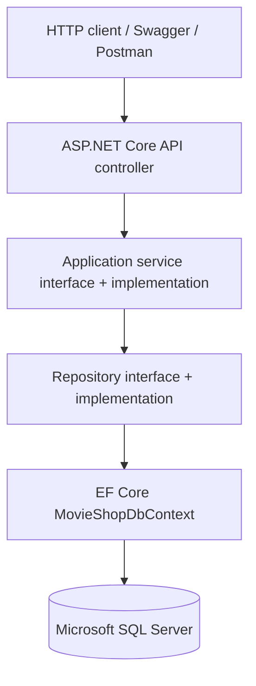

MovieShopAPI 🎬
ASP.NET Core REST API for a movie-store domain — C# · .NET 10 · Entity Framework Core · SQL Server · Swagger/OpenAPI · Docker

Source code · Related MVC application
Overview
MovieShopAPI is a backend-focused .NET project that demonstrates how to organize a movie-store application around HTTP controllers, business services, repository abstractions, and relational persistence. Its current public endpoints support movie discovery and genre-based browsing. The wider solution also defines data models and services for users, accounts, favorites, reviews, purchases, and administrative reporting.

The project is designed as a learning and portfolio application, not a deployed commercial movie store. In particular, the presence of a service or entity does not mean every related API endpoint or security workflow is complete.
What the project demonstrates
- Building asynchronous HTTP GET endpoints using ASP.NET Core Web API.
- Separating controllers, services, repository contracts, and EF Core implementations.
- Modeling a relational database with one-to-many and many-to-many relationships.
- Loading related movie data (genres, cast, crew, and trailers) with Entity Framework Core.
- Implementing paginated genre queries with Skip, Take, and a total record count.
- Exploring API routes and response models through Swagger/OpenAPI.
- Structuring an API for local development and container builds.
Implemented API capabilities
Area	Current implementation	Notes
Movie discovery	Endpoints for top-rated and highest-grossing movies	The current “top-rated” repository query sorts by review count, not average rating; see improvements below.
Movie details	Look up a movie by numeric ID	Returns 404 Not Found when no movie exists.
Genres	List available genres	Uses a genre service and EF Core repository.
Genre browsing	Retrieve movies in a genre with pagination	Supports pageSize and pageNumber query parameters.
Database model	EF Core entities and relationships for movie-store data	Includes users, reviews, favorites, purchases, roles, and reports.
Account/admin features	Domain service and repository code is present	Do not treat these as fully exposed, secured API workflows.
File uploads / payment processing	Not implemented as a documented public API capability	Future extension areas.

API endpoint reference
Routes verified from the MVC-style API controllers in MovieAPI/Controllers:
Method	Endpoint	Description
GET	/api/movies/toprated	Return a limited list of movies ranked by the current repository logic.
GET	/api/movies/highestgrossing	Return up to 30 movies ordered by revenue.
GET	/api/movies/{id}	Return details for one movie or 404.
GET	/api/genres	Return the genre catalog.
GET	/api/genres/{id}/movies?pageSize=30&pageNumber=1	Return a paginated collection of movies in a genre.

These are the endpoints verified in the repository source. Other domain objects and services are not listed as public routes unless a matching API controller is implemented.

Technology stack
Layer	Technology	Purpose
Language and runtime	C# / .NET 10	Backend development
HTTP API	ASP.NET Core Web API	Controllers, routing, JSON responses
Database access	Entity Framework Core 10	Queries, entity mapping, data access
Database	Microsoft SQL Server	Relational persistence
API exploration	Swashbuckle / Swagger UI	Interactive API documentation
Container build	Docker (multi-stage Dockerfile)	Build and package the API
Version control	Git / GitHub	Source history and collaboration

Architecture
The solution separates responsibilities into three .NET projects:
MovieShopAPI/
├── ApplicationCore/           # Domain entities, models, service/repository contracts
├── Infrastructure/            # EF Core DbContext, repositories, services, helpers
├── MovieAPI/                  # API controllers, startup configuration, appsettings
├── Dockerfile                 # Multi-stage .NET container build
└── MovieShopAPI.slnx          # Solution file

ApplicationCore defines entity classes, view/request models, and interfaces that express the application's contracts. Infrastructure implements data access and services, including MovieShopDbContext. MovieAPI accepts HTTP requests and registers the dependencies in Program.cs.
Example request flow
When a client requests GET /api/movies/{id}:
1. MoviesController receives the movie ID.
2. IMovieService provides the movie-details operation.
3. The movie repository queries SQL Server via EF Core, including related data.
4. The service maps the entity into a MovieDetailsModel.
5. The controller returns JSON (200 OK) or 404 Not Found.
Relational data model
MovieShopDbContext defines entity sets for:
- Catalog: Movie, Genre, MovieGenre, Trailer, Cast, MovieCast, Crew, MovieCrew.
- Users and access data: User, Role, UserRole.
- User activity: Review, Favorite, Purchase.
- Administration: Report.
Join entities use composite keys where appropriate (for example, movie/genre, movie/user favorites, and user/role associations). EF Core navigation properties and foreign keys connect movies to their genres, cast, crew, reviews, purchases, and favorites.

This is database/schema modeling, not a claim that every potential feature has a public API endpoint.
Run locally
Prerequisites
- .NET 10 SDK
- Microsoft SQL Server instance (or SQL Server Express / LocalDB on supported Windows systems)
- Git; an editor such as Visual Studio or VS Code is optional
- Docker Desktop or another compatible Docker engine (optional)
1. Clone and restore
git clone https://github.com/Yashaswini944/MovieShopAPI.git
cd MovieShopAPI
dotnet restore MovieShopAPI.slnx
dotnet build MovieShopAPI.slnx
2. Configure the connection string
MovieAPI/Program.cs reads ConnectionStrings:MovieShopDb. Replace the machine-specific SQL Server connection configured in the checked-in MovieAPI/appsettings.json for your environment.

For local development, prefer .NET user secrets rather than committing credentials:
dotnet user-secrets init --project MovieAPI/MovieAPI.csproj
dotnet user-secrets set "ConnectionStrings:MovieShopDb" \
  "Server=YOUR_SQL_SERVER;Database=MovieShopDb;Integrated Security=True;TrustServerCertificate=True" \
  --project MovieAPI/MovieAPI.csproj
The example assumes integrated Windows authentication; for other setups, use a valid SQL Server connection string for your environment. Never commit passwords or production connection strings. User secrets are for local development, not a production secret store.
3. Prepare the database
The application needs a SQL Server database containing the tables and relevant movie data. If the repository includes usable EF Core migrations, apply them with:
dotnet tool install --global dotnet-ef
dotnet ef database update --project Infrastructure/Infrastructure.csproj \
  --startup-project MovieAPI/MovieAPI.csproj
If migrations are not present, the schema must first be created and checked against the model. The database is not assumed to initialize and seed itself on first run. A SQL Server instance and suitable sample records are necessary to see populated movie responses.
4. Start the API
dotnet run --project MovieAPI/MovieAPI.csproj --launch-profile http
The current HTTP launch profile uses http://localhost:5229 unless overridden. Open http://localhost:5229/swagger to inspect available actions, or use any REST client.
5. Example requests
curl -i http://localhost:5229/api/movies/toprated
curl -i http://localhost:5229/api/movies/highestgrossing
curl -i http://localhost:5229/api/movies/1
curl -i http://localhost:5229/api/genres
curl -i 'http://localhost:5229/api/genres/1/movies?pageSize=10&pageNumber=1'
Results depend on the records in your local database. The movie and genre IDs are examples, not guaranteed seed values.
Docker build
A multi-stage Dockerfile is provided at the repository root; the final container runs the compiled MovieAPI.dll.
docker build -t movieshop-api .
The container does not include SQL Server. Supply access to a running SQL Server and configure ConnectionStrings__MovieShopDb in the container environment. Do not bake credentials into the Docker image or publish them in a command transcript.
Testing and validation
Swagger UI and Postman can be used to inspect HTTP responses and validate the published endpoints. Recommended checks include:
Scenario	Expected behavior
Valid movie ID	Returns a movie details response.
Unknown movie ID	Returns 404 Not Found.
List genres	Returns available genre records.
Genre pagination	Returns the requested page and metadata.
Database unavailable	Identify and report the connection/configuration error.

A dedicated automated test suite and coverage results are not documented as part of the current repository. Automated unit/integration tests should be added before describing this project as fully tested.
Security and implementation status
This repository is a development-stage example. Domain account services exist, but the current startup pipeline does not establish complete bearer-token or cookie-based authentication. The password helper uses a salted SHA-256 construction, which should be replaced with an approved adaptive password-hashing approach (for example, ASP.NET Core Identity's password hasher) before production use.

Other production improvements include validation, access control, centralized error handling, safe secrets management, logging, and an appropriate Swagger configuration for non-development environments.
Planned improvements
1. Add automated unit and integration tests, with CI to restore, build, and test each change.
2. Correct the top-rated query to rank movies by average review rating rather than count of reviews.
3. Add input validation and bounds for pagination parameters.
4. Implement an authentication/authorization scheme and protected user/admin endpoints.
5. Provide reproducible migrations and non-sensitive sample data for local setup.
6. Add consistent API error responses and operational logging.
7. Expand APIs for domain functionality that currently lives only in service/repository code.
8. Add an OpenAPI example collection and API response examples verified against the running app.
Related project
MovieShopApp is a separate ASP.NET Core MVC movie-store implementation using a similar layered approach. The MVC application currently accesses its own services/database layer; it should not be represented as a frontend already connected to this REST API.
Author
Yashaswini — GitHub profile
Portfolio project demonstrating .NET API development, layered architecture, Entity Framework Core, SQL Server, and practical backend concepts.
