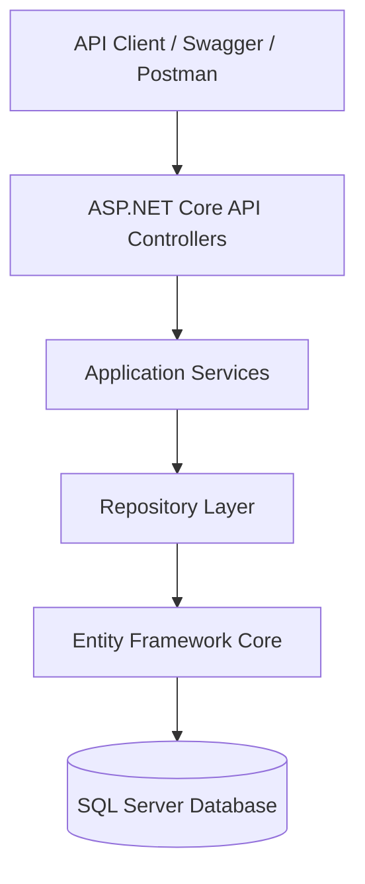

# MovieShopAPI 🎬

**ASP.NET Core REST API for a Movie Store**

**Technologies:** C# | .NET 10 | ASP.NET Core Web API | Entity Framework Core | SQL Server | Swagger | Docker

## Overview

MovieShopAPI is a backend-focused application developed using ASP.NET Core Web API, C#, Entity Framework Core, and SQL Server.

The project demonstrates the design and implementation of a layered backend architecture for a movie-store platform. It focuses on RESTful API development, relational database design, dependency injection, repository patterns, asynchronous programming, and separation of business logic from data access.

The currently implemented API endpoints support movie discovery, movie details, genre listings, and paginated movie browsing.

The solution also contains domain entities and supporting services for users, roles, reviews, favorites, purchases, and administrative operations.

This is a portfolio and learning project intended to demonstrate backend engineering concepts rather than a production-ready commercial application.

## Key Features

### 1. RESTful API Development

- Developed HTTP GET endpoints using ASP.NET Core Web API.
- Implemented controller-based routing.
- Used asynchronous methods for database operations.
- Returned structured JSON responses.
- Implemented appropriate HTTP responses such as `200 OK` and `404 Not Found`.
- Organized API functionality using services and repositories.

### 2. Movie Management and Discovery

- Retrieve top-rated movies using the current repository ranking logic.
- Retrieve highest-grossing movies.
- Fetch detailed information for individual movies.
- Access related movie information through Entity Framework Core.
- Support genre-based browsing.

### 3. Genre Management

- Retrieve available movie genres.
- Fetch movies belonging to a selected genre.
- Implement pagination using page number and page size.
- Return paginated results with supporting metadata.

### 4. Database Integration

- Integrated Microsoft SQL Server using Entity Framework Core.
- Created domain models for movie-store operations.
- Configured relationships between entities.
- Used repository abstractions to separate database operations from application services.
- Worked with LINQ queries and asynchronous data retrieval.

### 5. Layered Architecture

The application is organized into three projects:

- **ApplicationCore:** Domain entities, application models, and interfaces.
- **Infrastructure:** Database context, repository implementations, and application services.
- **MovieAPI:** REST API controllers, configuration, and dependency registration.

This separation improves maintainability, testability, and organization.

## Technology Stack

| Category | Technologies |
|---|---|
| Language | C# |
| Framework | ASP.NET Core Web API, .NET 10 |
| ORM | Entity Framework Core |
| Database | Microsoft SQL Server |
| Architecture | Layered Architecture, Repository Pattern |
| API Documentation | Swagger / OpenAPI |
| Containerization | Docker |
| Version Control | Git, GitHub |
| Development Concepts | Dependency Injection, LINQ, Async/Await, REST APIs |

## Project Structure

```text
MovieShopAPI/
│
├── ApplicationCore/
│   ├── Entities/
│   ├── Models/
│   └── Contracts/
│
├── Infrastructure/
│   ├── Data/
│   ├── Repositories/
│   ├── Services/
│   └── Helpers/
│
├── MovieAPI/
│   ├── Controllers/
│   ├── Program.cs
│   └── appsettings.json
│
├── Dockerfile
└── MovieShopAPI.slnx
```

The folder structure above is a simplified architectural representation of the solution.

## Application Architecture



### Request Processing

1. An HTTP request is sent to an API endpoint.
2. The API controller receives the request.
3. The controller calls the appropriate service.
4. The service coordinates application logic.
5. The repository accesses the database using Entity Framework Core.
6. The result is returned to the client as an HTTP response.

## API Endpoints

The following routes are implemented in the current API controllers.

| Method | Endpoint | Description |
|---|---|---|
| GET | `/api/movies/toprated` | Retrieves movies using the current top-rated ranking logic |
| GET | `/api/movies/highestgrossing` | Retrieves highest-grossing movies |
| GET | `/api/movies/{id}` | Retrieves movie details |
| GET | `/api/genres` | Retrieves available genres |
| GET | `/api/genres/{id}/movies?pageSize=30&pageNumber=1` | Retrieves paginated movies by genre |

### Example API Request

```http
GET /api/movies/1
```

The endpoint retrieves information for a movie with the specified ID.

When a matching movie does not exist, the controller returns `404 Not Found`.

### Pagination Example

```http
GET /api/genres/1/movies?pageSize=10&pageNumber=1
```

This retrieves the requested page of movies associated with a particular genre.

## Database Design

The application uses a relational database model with the following entity groups.

### Movie Catalog

- Movie
- Genre
- MovieGenre
- Trailer
- Cast
- MovieCast
- Crew
- MovieCrew

### User Management

- User
- Role
- UserRole

### User Activity

- Review
- Favorite
- Purchase

### Administration

- Report

### Entity Relationships

The database supports relationships including:

- Movies associated with multiple genres.
- Movies associated with cast and crew members.
- Users associated with roles.
- Users associated with movie reviews.
- Users associated with favorite movies.
- Users associated with purchase records.

Entity Framework Core is used to configure and manage these relationships.

## Backend Design Principles

### Separation of Concerns

Controllers, services, and repositories have different responsibilities.

### Dependency Injection

Application dependencies are registered and resolved using ASP.NET Core dependency injection.

### Repository Pattern

Database operations are encapsulated within repository implementations.

### Asynchronous Programming

Asynchronous database methods support non-blocking request handling.

### Relational Data Modeling

Foreign keys, navigation properties, and join entities support structured data relationships.

## Installation and Setup

### Prerequisites

- .NET 10 SDK
- Microsoft SQL Server
- Git
- Visual Studio, VS Code, or another compatible IDE
- Docker (optional)

### Step 1: Clone the Repository

```bash
git clone https://github.com/Yashaswini944/MovieShopAPI.git
cd MovieShopAPI
```

### Step 2: Restore Dependencies

```bash
dotnet restore MovieShopAPI.slnx
```

### Step 3: Build the Project

```bash
dotnet build MovieShopAPI.slnx
```

### Step 4: Configure SQL Server

The application reads the database connection string from:

```text
ConnectionStrings:MovieShopDb
```

Configure a valid SQL Server connection string for your local environment.

For local development, .NET user secrets are preferable to storing sensitive credentials in source control.

### Step 5: Prepare the Database

The project requires a SQL Server database with the appropriate schema and movie records.

If valid Entity Framework Core migrations are available, apply them using the EF Core tooling.

Database creation and automatic data seeding should not be assumed without verifying the current project configuration.

### Step 6: Run the Application

```bash
dotnet run --project MovieAPI/MovieAPI.csproj --launch-profile http
```

The checked-in HTTP launch profile uses:

```text
http://localhost:5229
```

### Step 7: Open Swagger

```text
http://localhost:5229/swagger
```

Swagger allows available API endpoints to be inspected and tested.

## API Testing

Swagger and Postman can be used to validate API functionality.

Suggested test scenarios include:

| Test Scenario | Expected Result |
|---|---|
| Retrieve an existing movie | Returns movie information |
| Retrieve an unknown movie | Returns 404 |
| Retrieve available genres | Returns genre data |
| Retrieve movies by genre | Returns the requested collection |
| Change pagination parameters | Returns the corresponding page |
| Database connection failure | Produces a configuration or connection error |

A complete automated API test suite is not currently documented in the repository.

## Docker Support

The project includes a Dockerfile supporting container builds.

Build the image:

```bash
docker build -t movieshop-api .
```

A running SQL Server database and suitable connection configuration are still required.

The Docker image does not automatically provision the database.

## Security Considerations

The repository contains account-related domain functionality, but production-ready authentication and authorization are not fully implemented in the current public API.

Before production deployment, the application would require:

- Secure authentication and session or token handling.
- Role-based access control.
- Approved adaptive password hashing.
- Request validation.
- Centralized exception handling.
- Secure configuration and secrets management.
- Logging and monitoring.
- Automated security and integration tests.

## Current Limitations

- Public API endpoints primarily support movie discovery and genre browsing.
- Some user and administrative functionality exists in service and repository layers but is not exposed through complete secured API endpoints.
- The current top-rated movie query ranks by review count rather than average review rating.
- A complete automated test suite has not been verified.
- File uploads and payment processing are not implemented as verified public API features.
- Production deployment is not documented.

## Future Enhancements

- Implement secure authentication using ASP.NET Core Identity or an equivalent established framework.
- Add role-based authorization.
- Expose additional user, review, favorites, and purchase-related API endpoints.
- Add request validation and standardized error responses.
- Improve movie rating calculations.
- Implement xUnit unit tests and integration tests.
- Add GitHub Actions CI.
- Create reproducible database migrations and sample development data.
- Improve logging and application monitoring.
- Expand API documentation.

## What I Learned

Through this project, I strengthened my understanding of:

- Backend API design.
- ASP.NET Core development.
- Entity Framework Core.
- SQL Server database integration.
- Layered application architecture.
- Repository and service patterns.
- Dependency injection.
- Asynchronous programming.
- Relational database relationships.
- API debugging and validation.

## Related Project

**MovieShopApp — ASP.NET Core MVC Application**

https://github.com/Yashaswini944/MovieShopApp

MovieShopApp demonstrates server-rendered UI functionality and database-backed workflows using a similar layered architecture.

The MVC application currently uses its own application services and database access layer rather than calling this REST API directly.

**Project Type:** Backend Development / ASP.NET Core Web API / SQL Server
